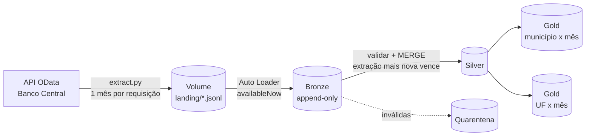

# Lakehouse do Pix no Databricks

[](https://github.com/amanda-martins-data/lakehouse-pix-databricks/actions/workflows/ci.yml)

Arquitetura Medallion (**Bronze → Silver → Gold**) no **Databricks**, com
**PySpark**, **Delta Lake**, **Auto Loader**, **Unity Catalog** e um **Job**
publicado por **Databricks Asset Bundle**, sobre os dados abertos do Banco
Central: transações Pix por município, mês a mês, desde o lançamento em
novembro de 2020.

Projeto 15 do meu portfólio de Engenharia e Arquitetura de Dados. Veja o
[perfil completo](https://github.com/amanda-martins-data).

> **Status:** em construção. Código, testes e documentação prontos; primeira
> execução na Databricks Free Edition em andamento. A etapa no Azure Databricks
> com Terraform vem no fechamento (ver [decisions/0001](decisions/0001-free-edition-primeiro-azure-no-fechamento.md)).

## Arquitetura



Um Job com cinco tarefas (setup, extração, bronze, silver, gold) roda todo
dia 5, em computação serverless.

## O que a fonte ensinou

A documentação da API não conta tudo. Medi direto na fonte
([docs/achados-da-fonte.md](docs/achados-da-fonte.md)):

| Achado | Risco | Tratamento |
|---|---|---|
| `DataBase=202510` devolve **14 meses**, não um | Arquivo de "outubro" com 78 mil linhas | `$filter` por mês e recusa de linhas de outro mês |
| O mês corrente sai **parcial** (novembro com 75% de outubro no dia 24) | "Queda" de 25% que não existe | `mes_parcial` na Silver; crescimento só entre meses completos |
| Uma linha **"N/D"** sem código soma **R$ 7,9 bi** no mês | Totais que não batem com o Banco Central | Linha mantida, em grupo próprio na Gold |
| Código nulo na chave **duplica a linha** a cada `MERGE` | Totais inflando em silêncio | Chave substituta `municipio_chave` ([0003](decisions/0003-chave-substituta-para-municipio-nao-informado.md)) |
| `$skip` devolve **erro 500**: a API não pagina | Mês cortado sem aviso | Um mês por requisição; falha se a resposta vier cheia |

## Decisões

| ADR | Decisão |
|---|---|
| [0001](decisions/0001-free-edition-primeiro-azure-no-fechamento.md) | Desenvolver na Free Edition, fechar no Azure Databricks com Terraform |
| [0002](decisions/0002-reprocessar-os-tres-meses-mais-recentes.md) | Reprocessar os três meses mais recentes, guardando cada versão |
| [0003](decisions/0003-chave-substituta-para-municipio-nao-informado.md) | Chave substituta para a linha sem município |
| [0004](decisions/0004-notebooks-e-jobs-antes-de-pipelines-declarativos.md) | Notebooks e Jobs antes de pipelines declarativos |

## Qualidade e testes

- **21 testes** com PySpark local, sem precisar de Databricks, rodando no CI a
  cada push. Usam 23 linhas reais da API como amostra.
- Regras da Silver: mês fora do intervalo, código do IBGE sem 7 dígitos,
  município sem UF, métrica negativa ou nula. Linhas que falham vão para a
  quarentena com o motivo.
- O notebook da Gold falha se a soma por município ou por UF não bater com a
  Silver, e o da Silver falha se houver chave repetida depois do `MERGE`.

## Estrutura

```
.
├── databricks.yml             # bundle: targets free e azure
├── resources/pix_job.yml      # o Job: 5 tarefas serverless, todo dia 5
├── src/pix_lakehouse/
│   ├── extract.py             # API OData, 1 requisição e 1 arquivo por mês e extração
│   ├── schema.py              # contrato da fonte e nomes das tabelas
│   └── transform.py           # Bronze -> Silver -> Gold como funções puras
├── notebooks/                 # 00_setup, 01_extracao, 02_bronze, 03_silver, 04_gold
├── scripts/baixar_pix.py      # extração pelo computador, se o workspace não alcançar a API
├── tests/                     # pytest + amostra real
├── decisions/                 # ADRs
└── docs/                      # achados da fonte, como rodar
```

## Como rodar

Passo a passo em [docs/runbook.md](docs/runbook.md). Em resumo:

```bash
databricks auth login --host https://SEU-WORKSPACE.cloud.databricks.com
databricks bundle deploy -t free
databricks bundle run pix_lakehouse -t free
```

## Fonte e licença dos dados

Banco Central do Brasil, [Estatísticas do Pix](https://dadosabertos.bcb.gov.br/dataset/pix),
licença ODbL.
